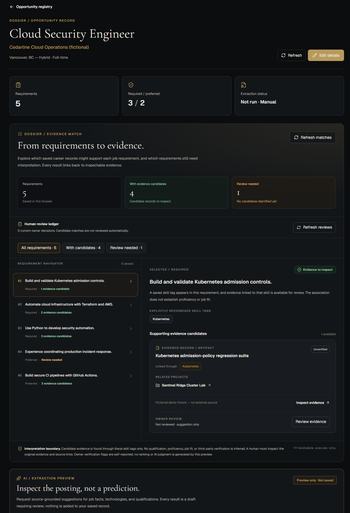

# The Continental

**A system for managing professional history and connecting career experience to new opportunities.**

Career records often end up scattered across résumés, project notes, and saved job postings. The Continental keeps those records connected in a local workspace, with the supporting evidence available when you need to examine an opportunity.

**Latest release:** [v0.3.0 — Evidence Match](https://github.com/danielguillaumont/the-continental/releases/tag/v0.3.0)

## Preview

[](docs/screenshots/dossier-v03-cloud-security-desktop.png)

*Fictional demo data.* [Cloud Security Dossier](docs/screenshots/dossier-v03-cloud-security-desktop.png) · [Application Security Dossier](docs/screenshots/dossier-v03-application-security-desktop.png) · [Platform Reliability Dossier](docs/screenshots/dossier-v03-platform-reliability-desktop.png)

## What works

- **Career record:** Manage profile, experience, projects, evidence, skills, and certifications as connected records.
- **Dossier:** Save job postings, preserve the original source, and organize required and preferred qualifications.
- **Evidence Match:** Find candidate evidence through explicit Skill-tag links. Inspect supporting records and requirements with no candidates.
- **Human review:** Record, revise, or remove your own evidence decisions, with notes and stale-review indicators.

## Stack

- **Frontend:** Next.js 16, React 19, TypeScript, Tailwind CSS 4
- **Backend:** FastAPI, Pydantic, SQLAlchemy, PostgreSQL 17, Alembic
- **Development:** Docker Compose, GitHub Actions

## Run locally

**Requires:** Python 3.12+, Node.js 22+, Docker Desktop with Compose, and Git. Commands below use Windows PowerShell and assume a **fresh clone**.

**DB** — from a new working directory:

```powershell
git clone https://github.com/danielguillaumont/the-continental.git
cd the-continental
Copy-Item .env.example .env
docker compose up -d postgres
```

**API Server** — from the repository root:

```powershell
cd apps/api
py -3 -m venv .venv
.\.venv\Scripts\python.exe -m pip install -r requirements-dev.txt
.\.venv\Scripts\python.exe -m alembic upgrade head
.\.venv\Scripts\python.exe -m uvicorn app.main:app --reload --host 127.0.0.1 --port 8000
```

**Web** — from the repository root:

```powershell
cd apps/web
npm.cmd ci
npm.cmd run dev -- --hostname 127.0.0.1
```

Web: `http://127.0.0.1:3000` · API docs: `http://127.0.0.1:8000/docs`

Do not overwrite an existing `.env`, reset Docker volumes, or downgrade a populated database.

## Release status

**v0.3.0 is published.** The release passed 126 backend tests, 111 frontend tests, 13 read-only API checks, CI, lint, and a production build. [Read the release notes](https://github.com/danielguillaumont/the-continental/releases/tag/v0.3.0).

**Scope:** This is a local-only, single-user development application without authentication or public deployment hardening. Evidence Match uses literal Skill associations, not job-fit scores or independent qualification checks. Optional AI extraction previews require explicit consent; live external model integration has not been verified. Screenshots use fictional records.

**Next:** v0.4 — Import. Earlier releases: [v0.1.0](https://github.com/danielguillaumont/the-continental/releases/tag/v0.1.0) · [v0.2.0](https://github.com/danielguillaumont/the-continental/releases/tag/v0.2.0). Detailed implementation history is in [`docs/development/`](docs/development/) and [`docs/releases/`](docs/releases/).
