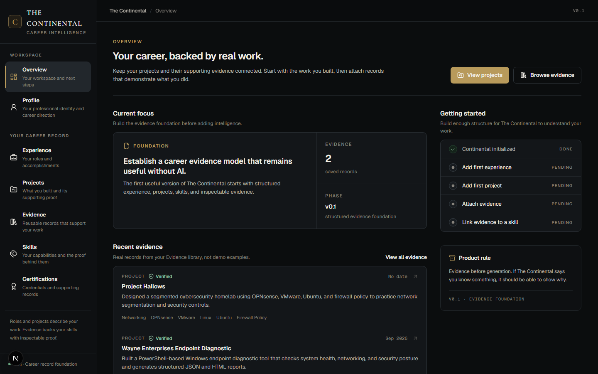
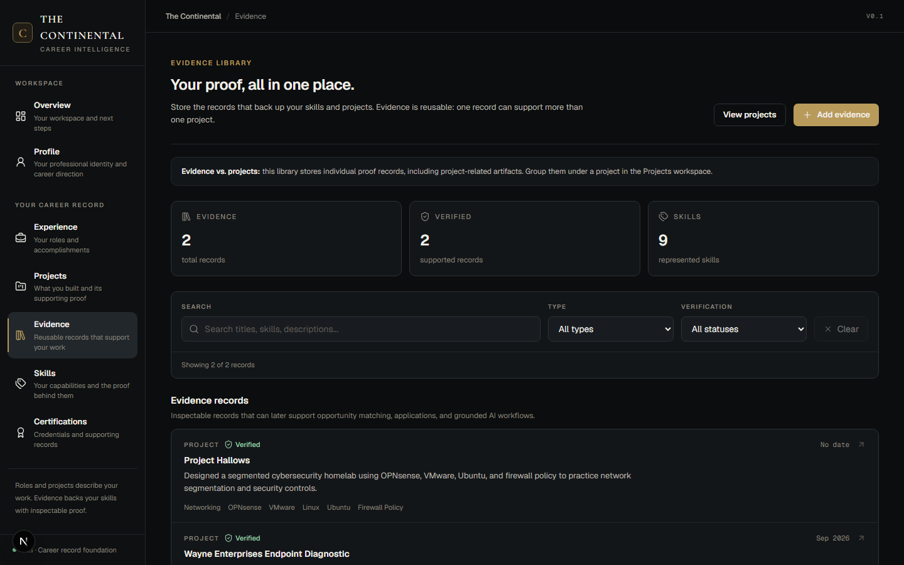

# The Continental

**Career intelligence built around evidence, not vague claims.**

The Continental is a career intelligence platform that turns projects, experience, certifications, skills, and other career evidence into structured data for opportunity analysis, applications, interview preparation, and future grounded AI workflows.

**Evidence → Understand Opportunity → Take Action → Create Better Evidence**

---

<!-- continental-portfolio:begin -->
## See it in action

The Continental turns career evidence into structured, inspectable records. These screenshots are from the **v0.1.0 Career Record Foundation** running locally.

### Overview workspace

[](docs/screenshots/overview-desktop.png)

### Evidence library

[](docs/screenshots/armory-desktop.png)

Evidence records can be reused across projects, experiences, certifications and skills without duplicating the originals. Verification labels are owner-entered, not independent assessments.

### What v0.1.0 delivers

- **Profile:** persistent professional identity, career direction and portfolio links.
- **Experience:** employment, engagements, accomplishments, linked projects and evidence.
- **Projects:** structured project records with attach/detach evidence workflows.
- **Evidence:** searchable records with sources, verification labels and skills.
- **Skills:** an evidence-derived inventory with inspectable supporting records.
- **Certifications:** credential metadata, date-aware status, linked skills and evidence.

**Engineering:** FastAPI, PostgreSQL, SQLAlchemy, Alembic, Next.js, React, TypeScript, regression tests, and GitHub Actions CI. Release checks included **38 backend tests and 51 frontend tests**, plus ESLint, a production build, and a production-dependency audit.

**Release:** [v0.1.0 - Career Record Foundation](https://github.com/danielguillaumont/the-continental/releases/tag/v0.1.0) | **Next:** v0.2 Dossier - structured opportunity records from supplied job-posting text.

> **Scope:** local, unauthenticated, single-user development milestone. Not publicly hosted; no login, tenant isolation, AI matching or independent credential verification. Do not publicly deploy this API or database with personal data.
<!-- continental-portfolio:end -->

## Current Status

**v0.1.0 - Career Record Foundation (released November 7, 2026).**

The first career-record foundation is implemented: Profile, Experience, Projects, Evidence, Skills, and Certifications are backed by persistent models and working UI. Records can be linked without duplicating the originals.

The next milestone is v0.2 - Dossier, starting with structured job opportunity records.

This repository is still a local-only development application, not a hosted service.


### v0.2 Dossier - in progress

Slice 2A introduced the source-preserving **Opportunity Registry backend** and editable required/preferred requirements. Slice 2B introduced the working Dossier UI, including manual intake, detail views, and safe save recovery. The original source text and stable requirement IDs are preserved. See [`2A`](docs/development/v02-dossier-1a.md) and [`2B`](docs/development/v02-dossier-1b.md).

Slice 2C1 adds an **opt-in, review-only AI extraction preview endpoint** (`POST /opportunities/{id}/extraction-preview`). It validates a strict JSON response and requires exact source excerpts for all proposed facts. Preview results are **not saved** or applied to existing opportunities. No new migration is needed. Provider setup is described in [`docs/development/v02-dossier-2c1.md`](docs/development/v02-dossier-2c1.md).

**Current limitations:** Extraction is disabled unless configured explicitly; the UI review/acceptance workflow comes later in 2C/2D. No job-to-evidence matching or AI-generated application material is implemented. v0.2 is in active development; the published release remains v0.1.0.

### Working

- Responsive Next.js application shell with distinct Overview, Profile, Experience, Projects, Evidence, Skills, and Certifications navigation
- Overview dashboard (formerly Lobby)
- Evidence library (existing Armory URLs preserved)
- Add Evidence workflow
- Evidence detail views
- Edit Evidence workflow
- Delete Evidence workflow with confirmation
- Armory search and filtering
- Live filtered result counts
- Reusable skill entities
- Many-to-many evidence and skill relationships
- Case-insensitive skill reuse and normalization
- Skills & Proof inventory: searchable skill names, evidence coverage filters, record counts, and drill-down with provenance (read-only; no invented proficiency scores)
- Profile Management: owner-entered career identity with headline, summary, local contact details, portfolio links, target roles and availability; persistent API, responsive workspace and regression tests
- Certification Registry: create/edit/delete credentials; issuer, optional issue/expiration dates, credential URL, description; reusable Skill/Evidence links; and date-based status filtering
- Skill coverage derived from saved evidence status, including unsupported skills whose last evidence was removed
- FastAPI backend
- PostgreSQL persistence
- SQLAlchemy relational data model
- Alembic migrations with data-preserving skill normalization
- Evidence validation with Pydantic
- Database-backed evidence summaries and skill counts
- Evidence provenance and record history
- Desktop and mobile navigation
- Project workspace: dedicated detail pages, clearer project list, shared create/edit form, and safe deletion confirmation
- Projects can link and unlink existing evidence (without deleting original evidence)
- Project-aware evidence creation: save, auto-attach and return to the project; attachment failures preserve the new evidence ID for safe retry
- Project/evidence relational tables with additive Alembic migration
- API integration tests for project lifecycle and relationship integrity
- Structured Experience API, PostgreSQL model, additive migration, and responsive Experience workspace (list, create, edit, detail, delete, project/evidence associations)

### v0.1.0 release validation

- Local acceptance on November 7, 2026: **38 backend tests and 51 frontend tests passed**; ESLint, the Next.js production build and a production-only npm audit passed (0 reported vulnerabilities).
- Database at Alembic revision `b7c2e49a1d03`, with existing records preserved through the Profile migration. These are **local checks**, not a claim of production readiness.
- Both GitHub Actions CI jobs passed on the v0.1.0 release commit. See [`docs/releases/v0.1.0-rc.md`](docs/releases/v0.1.0-rc.md).
- Screenshots must use sanitized demonstration records. Do not publish actual profile or career data.

---

## The Idea

Most career tools treat a resume as the database.

The Continental treats the resume as an output. The source of truth is the evidence behind a career:

- work completed
- projects built
- technologies used
- certifications earned
- artifacts created
- skills supported by real examples

Future AI features will operate on this evidence instead of inventing it.

---

## Product Areas

| Area | Purpose |
| --- | --- |
| **Overview** | Home workspace and next actions |
| **Profile** | Professional identity, career direction and portfolio links |
| **Experience** | Roles, organizations, accomplishments, and supporting work |
| **Projects** | Project records grouped with supporting evidence |
| **Evidence** | Reusable records supporting projects, skills and experience |
| **Skills** | Inspect a skill and the exact evidence records that support it |
| **Certifications** | Store credentials, track date-based expiration, and link skills and supporting evidence |
| **Dossier** | Opportunity analysis |
| **Contracts** | Bounded missions for closing evidence gaps |
| **Archive** | Applications, interviews, and outcomes |
| **High Table** | Career and opportunity intelligence |

Only working product areas are exposed in the application.

---

## Tech Stack

- Next.js 16
- React 19
- TypeScript
- Tailwind CSS 4
- FastAPI
- Pydantic
- SQLAlchemy
- PostgreSQL 17
- Alembic
- Docker Compose

---

## Run Locally

Prerequisites: Python 3.12+, Node.js 22+, Docker Desktop with Compose, and Git. Use a fresh clone for these commands. They are Windows PowerShell instructions; the local `.env` is ignored by Git and must stay private.

From the repository root, in **DB**:

```powershell
Copy-Item .env.example .env
# If changing the sample password, update both POSTGRES_PASSWORD and the password in DATABASE_URL.
docker compose up -d postgres
```

In **API Server**, still from the repository root:

```powershell
cd apps/api
py -3 -m venv .venv
.\.venv\Scripts\python.exe -m pip install -r requirements-dev.txt
.\.venv\Scripts\python.exe -m alembic upgrade head
.\.venv\Scripts\python.exe -m uvicorn app.main:app --reload --host 127.0.0.1 --port 8000
```

In **Web**, from the repository root:

```powershell
cd apps/web
npm.cmd ci
npm.cmd run dev -- --hostname 127.0.0.1
```

For an existing local checkout, **do not overwrite `.env`, delete Docker volumes, or downgrade migrations**. Keep PostgreSQL data and private profile records out of public artifacts.

Web app:

```text
http://localhost:3000
```

API docs:

```text
http://127.0.0.1:8000/docs
```

Run API tests from `apps/api` using `.\.venv\Scripts\python.exe -m pytest tests -q`. In `apps/web`, use `npm.cmd run test:navigation`, `test:projects`, `test:workflow`, `test:experiences`, `test:skills`, `test:certifications`, `test:profile`, then `npm.cmd run lint`, `npm.cmd run build`, and `npm.cmd audit --omit=dev`. GitHub Actions runs the same suite on proposed changes.

The **Dossier** workspace (`/dossier`) is now available in the v0.2 development branch. It lets the owner paste and preserve a job posting, manually record its details, browse opportunities, and add/edit/delete required or preferred requirements. On a Dossier detail page, the original job text stays read-only beside the structured record. Source excerpts must match the saved posting exactly. Manual intake remains available without an AI provider. Slice 2C1 separately adds an optional, backend-only extraction preview which is disabled by default and cannot change saved data. Matching and external job fetching are not implemented. The backend migration `e42d1c8b90a7` was introduced in Slice 2A; neither 2B nor 2C1 requires further schema changes.

Choose **Projects** in the main navigation to create project records, then open a project to view its dedicated workspace, edit details, and link saved proof from **Evidence**. Routes `/armory` and `/armory/projects` remain unchanged for compatibility; project details use `/armory/projects/[id]`. Unlinking or deleting a project preserves underlying evidence. Creating new evidence from within a project automatically attaches it and returns to the project; a failed attachment can be retried without duplicating evidence. Use **Experience** (`/experiences`) to create role records and link existing Projects or Evidence without transferring ownership. Use **Skills** (`/skills`) to inspect evidence-derived skill coverage, then open an individual skill to see the original records and their source information. Skill records are not edited independently; evidence tags control relationships. A "verified" tag is owner-provided, not third-party certification. The Certifications workspace (`/certifications`) lets you record credentials and their dates, then link or detach existing Skills and Evidence without modifying the originals. A credential URL is an owner-entered link, not proof of issuer verification. The **Profile** workspace (`/profile`) calls `GET /profile` (404 until configured) and `PUT /profile` (create/update one career identity). This is still a **local-only, unauthenticated single-user development application**: do not expose the API or personally identifiable profile data on the public internet. User authentication and tenant separation are not yet implemented.

---

## Roadmap

| Version | Focus |
| --- | --- |
| v0.0 | Foundation |
| **v0.1** | **My Evidence** |
| v0.2 | Dossier |
| v0.3 | Evidence Match |
| v0.4 | Import |
| v0.5 | Armory Generation |
| v0.6+ | Contracts, Archive, workflows, integrations, intelligence |
| v1.0 | Reliable first major release |

---

## Product Principles

- Data first, AI second.
- Evidence is the source of truth.
- AI output should be grounded and inspectable.
- Only expose features that actually work.
- Add complexity only when the product requires it.

---

## Development

The Continental is under active development and intentionally public so its progression from structured career data to grounded AI workflows can be followed through the commit history.
